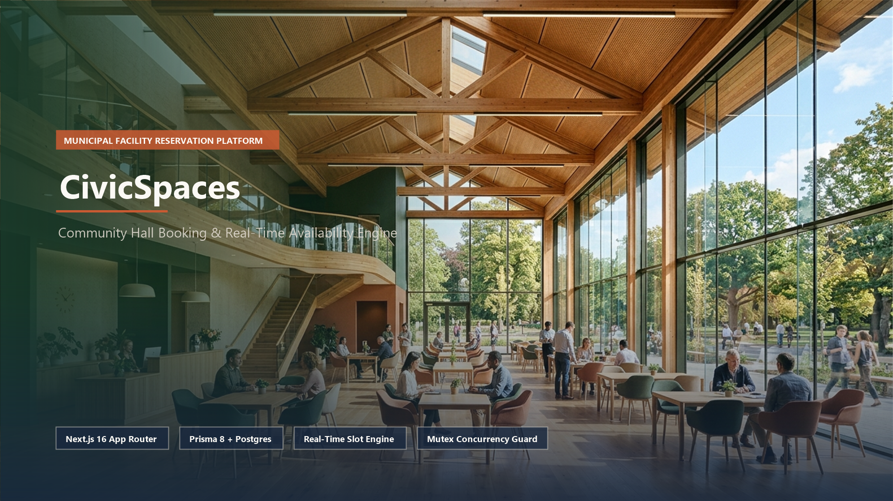

<p align="center">
  
</p>

# CivicSpaces — Community Hall Booking & Management System

CivicSpaces is a responsive, accessible web platform for municipal community hall reservations and civic facility management. The platform enables citizens to discover community halls, verify live schedule availability against approved bookings and maintenance closures, submit structured booking requests for administrative review, track request status, and view their submitted requests.

---

## Architecture & Technology Stack

- **Framework**: Next.js 16 (App Router with Partial Prerendering and Turbopack)
- **Language**: TypeScript (strict mode)
- **Database & Auth**: Supabase Postgres, Supabase Auth, and Row Level Security (RLS)
- **Client Libraries**: `@supabase/supabase-js`, `@supabase/ssr`
- **UI & Styling**: React 19, Tailwind CSS v4, Lucide React
- **Validation**: Zod (client and server-side schema validation)

---

## Phase 2 Features & Implemented Flow

1. **Supabase Database & Version-Controlled Migrations**
   - Version-controlled SQL migrations located in `supabase/migrations/`:
     - `20261116000001_initial_schema.sql`: Core tables (`profiles`, `halls`, `bookings`, `maintenance_windows`, `audit_events`), high-performance query indexes, PostgreSQL exclusion constraints, transaction-safe database stored procedures, and Row Level Security (RLS) policies.
     - `20261116000002_seed_data.sql`: Realistic development sample data (clearly labeled as sample data) with 6 civic facilities, sample approved/pending bookings, and scheduled maintenance windows.

2. **Database-Level Concurrency & Overlap Prevention**
   - Uses PostgreSQL `btree_gist` extension to enforce a strict **EXCLUDE constraint** on `bookings`:
     ```sql
     CONSTRAINT no_overlapping_approved_bookings
     EXCLUDE USING gist (
       hall_id WITH =,
       tstzrange(start_time, end_time) WITH &&
     )
     WHERE (status = 'APPROVED');
     ```
   - Transaction-safe database procedure `public.approve_booking_tx` that acquires row-level locks (`SELECT ... FOR UPDATE`), verifies that neither overlapping approved bookings nor active maintenance windows exist, and atomically confirms the reservation.

3. **Row Level Security (RLS) Policies**
   - **`halls`**: Public users can view active halls (`is_active = true`); only staff/admins can modify halls.
   - **`bookings`**: Public users can insert requests strictly with `status = 'PENDING'`. Authenticated requesters can query only their own booking requests (`auth.uid() = user_id`). Staff/admins can view and update all requests.
   - **`maintenance_windows`**: Public users can view scheduled maintenance windows for transparent facility availability.
   - **`profiles`**: Citizens can view and update only their own profile.

4. **Transparent Data Source Handling**
   - Automatically detects whether Supabase environment variables are configured via `isSupabaseConfigured()`.
   - When configured, queries run against live Supabase Postgres.
   - When credentials are not configured, provides an explicit, labeled **Development Sample Mode** notice (`<DataSourceIndicator />`) rather than pretending data is live.

5. **Live Hall Availability & Schedule View**
   - Real-time availability engine evaluates slot availability by date and hour.
   - Excludes approved bookings (`status = 'APPROVED'`) and active maintenance windows (`SCHEDULED` or `IN_PROGRESS`).
   - Core domain rule strictly observed: **Submitted requests in `PENDING` status do not block availability**.
   - Includes quick date stepping (Previous/Next day) and instant slot selection ("Use this time in request").

6. **Visitor Booking Request Form & Server-Side Validation**
   - Comprehensive booking request modal with event date, start/end time, event category, attendee headcount, contact information, and optional equipment requests.
   - Server-side validation via Zod in `/api/bookings` route handler.
   - Formally initializes every new request with `status: 'PENDING'`. A submitted request is never presented as confirmed.

7. **Dedicated Request Confirmation Page**
   - Route: `/request/confirmation?ref=REQ-YYYY-XXXX`
   - Highlights the reference number with one-click copy, event details, venue specifications, and explicit municipal notice explaining that the request is pending administrative review.

8. **Citizen Portal: "My Requests" View**
   - Route: `/my-requests`
   - Allows authenticated citizens to sign in with Supabase Auth to safely view and track their own booking requests under Row Level Security.
   - Unauthenticated visitors can also look up any request by reference number via `/track`.

---

## Supabase Setup Instructions

### 1. Create a Supabase Project
1. Sign in to [Supabase](https://supabase.com/dashboard).
2. Click **New Project**, choose an organization, provide a project name (e.g. `civic-spaces-booking`), set a strong database password, and select your region.

### 2. Obtain Project Credentials
In your Supabase project dashboard:
1. Navigate to **Project Settings** (gear icon) -> **API**.
2. Copy the **Project URL** (`https://<project-ref>.supabase.co`).
3. Copy the **anon / public** API Key.
4. Copy the **service_role** secret API Key (keep this private; never share or expose it to client-side code).

### 3. Configure Environment Variables
Create a `.env.local` file in the project root:
```bash
cp .env.example .env.local
```

Populate the values in `.env.local`:
```env
NEXT_PUBLIC_SUPABASE_URL=https://your-project-ref.supabase.co
NEXT_PUBLIC_SUPABASE_ANON_KEY=your-anon-public-key-here
SUPABASE_SERVICE_ROLE_KEY=your-service-role-key-here
NODE_ENV=development
```

### 4. Apply Database Migrations
You can apply the migrations using either the Supabase Dashboard or the Supabase CLI:

#### Option A: Supabase Dashboard SQL Editor (Recommended)
1. Open your project on [Supabase Dashboard](https://supabase.com/dashboard).
2. Go to the **SQL Editor** tab from the left sidebar.
3. Open `supabase/migrations/20261116000001_initial_schema.sql`, copy its entire content, paste it into the SQL Editor, and click **Run**.
4. (Optional for development testing) Open `supabase/migrations/20261116000002_seed_data.sql`, paste its content into the SQL Editor, and click **Run** to load realistic sample halls and bookings.

#### Option B: Supabase CLI
```bash
# Link your local repo to your remote Supabase project
npx supabase link --project-ref your-project-ref

# Push the migrations
npx supabase db push
```

---

## Running the Application Locally

1. **Install dependencies**:
   ```bash
   npm install
   ```

2. **Run domain verification tests**:
   ```bash
   npx tsx tests/verify-domain.mjs
   ```
   *(Verifies all 13 core domain rules including availability exclusion, pending non-blocking rules, and concurrency safeguards).*

3. **Start the development server**:
   ```bash
   npm run dev
   ```
   Open [http://localhost:3000](http://localhost:3000) in your browser.

4. **Production Build & Verification**:
   ```bash
   npm run build
   npm run start
   ```

---

## What Remains for Phase 3 (Administrator Phase)

The visitor and citizen reservation journey is complete. The following capabilities belong to the upcoming **Phase 3: Administrative Facility Operations**:

1. **Staff / Administrator Portal (`/admin`)**
   - Protected route requiring `role IN ('STAFF', 'ADMIN')` in `public.profiles`.
2. **Booking Review Queue**
   - Interface to review pending booking requests, view requester details, and examine potential conflicts.
   - Administrative decision actions (Approve / Reject / Request Information) invoking `approve_booking_tx`.
3. **Maintenance Management**
   - Schedule routine facility maintenance, repairs, or health inspections that automatically block visitor booking availability.
4. **Hall Management**
   - Facility editing (updating rates, capacities, images, amenities, and operational hours).
5. **Municipal Audit Log Explorer**
   - Real-time audit trail of all administrative decisions and status transitions.
